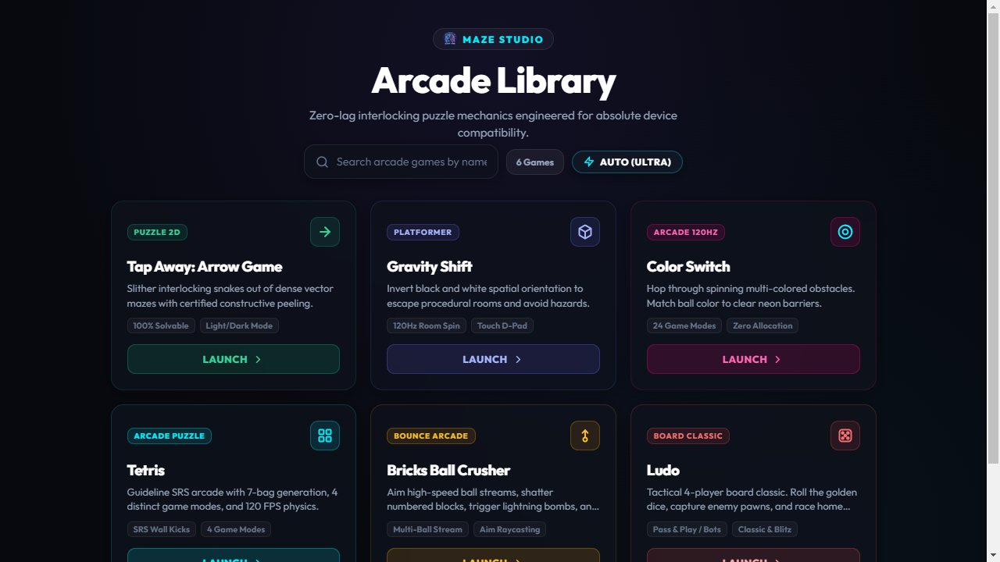
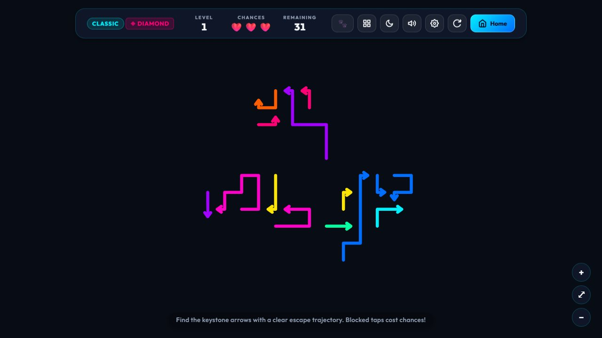
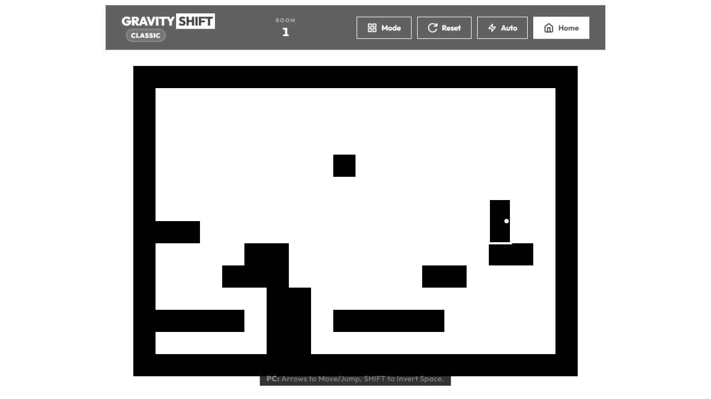
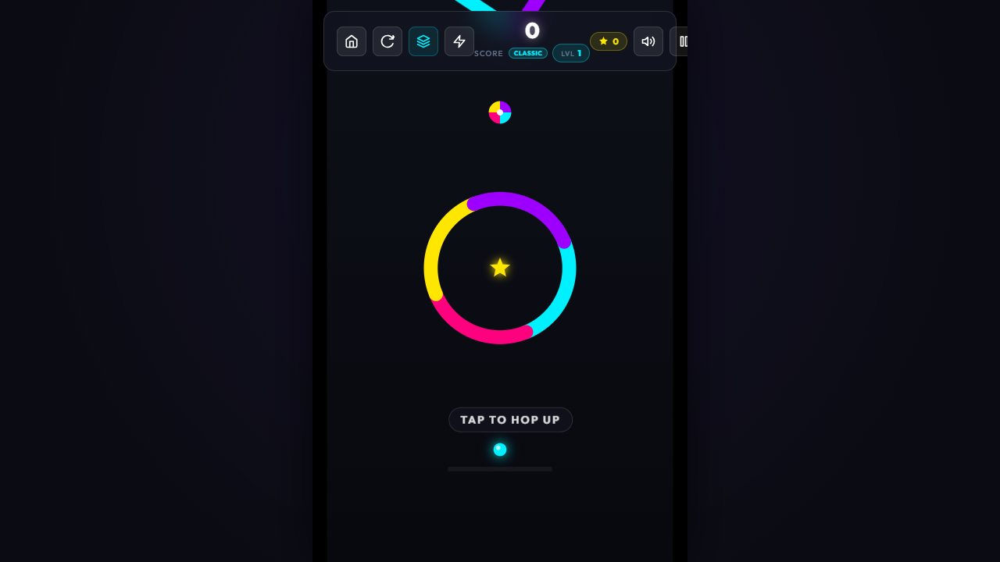
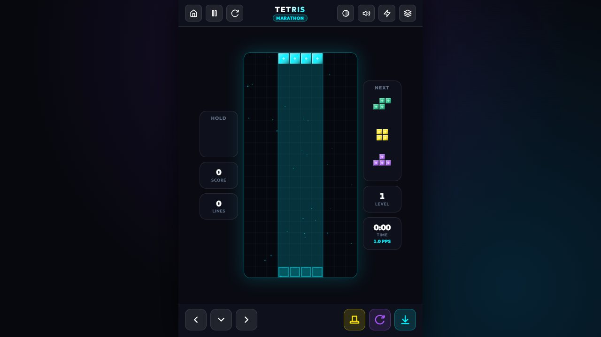
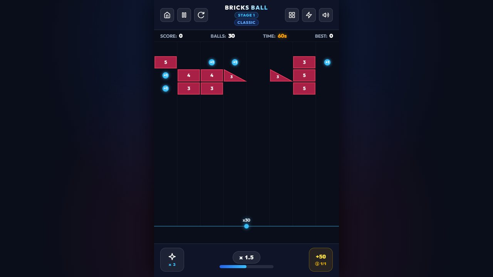
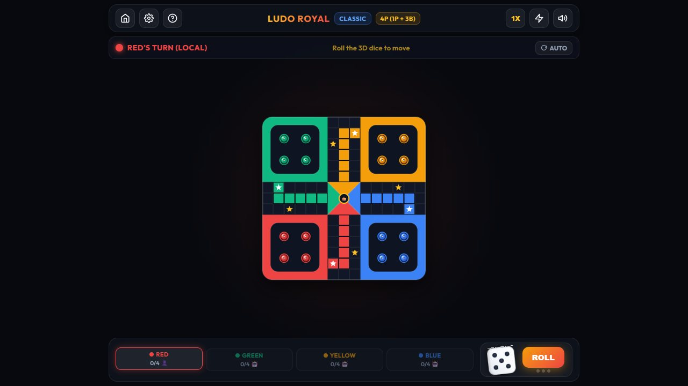

# GameHub (MAZE ARCADE) — 6-in-1 Cross-Platform 2D Arcade & Puzzle Suite

**Version `v7.8.1`**

 

---

## Visual Gallery

| Tap Away: Arrow Game | Gravity Shift | Color Switch |
| :---: | :---: | :---: |
|  |  |  |
| **Tetris (Guideline SRS 120 FPS)** | **Bricks Ball Crusher** | **Ludo** |
|  |  |  |

---

## 6 Built-in Games

GameHub (MAZE ARCADE) bundles six arcade and puzzle experiences in a single lightweight launcher:

1. **Tap Away: Arrow Game** — Directional puzzle challenges requiring spatial planning and clean sequence clearing.
2. **Gravity Shift** — Fast-paced reflex platforming with instant gravity inversion mechanics.
3. **Color Switch** — Precision timing arcade runner matching obstacle color gates.
4. **Tetris (Guideline SRS 120 FPS)** — Modern Guideline-compliant block stacker featuring Super Rotation System (SRS) kicks, hold queue, and high-refresh-rate 120 FPS responsiveness.
5. **Bricks Ball Crusher** — Physics-driven ricochet brick breaker with multi-ball combos and power-ups.
6. **Ludo** — Classic turn-based tabletop board game with smooth animations and local/AI play.

### Universal Graphics Profile (`AUTO` Hardware Adaptation)

GameHub includes an automatic **Universal Graphics Profile** (`AUTO` mode) that detects device capabilities at runtime and dynamically scales particle density, glow/post-processing effects, and frame pacing to maintain smooth performance across desktop GPUs and mobile SoCs.

---

## Platform Downloads

| Platform | Package | Architecture / Notes | Download |
| :--- | :--- | :--- | :--- |
| **Windows** | `.exe` | Windows x64 Installer / Portable | [GitHub Releases](https://github.com/rajpoot-8047/2D-GameHub/releases/latest) |
| **Android** | `.apk` | Android Universal APK | [GitHub Releases](https://github.com/rajpoot-8047/2D-GameHub/releases/latest) |
| **Linux** | `.deb` | Debian / Ubuntu x64 Package | [GitHub Releases](https://github.com/rajpoot-8047/2D-GameHub/releases/latest) |
| **Web / Netlify** | Browser | Instant Web App (No Install) | [Play Live Online](https://2dgamehub.netlify.app/) |
| **macOS** | Web / PWA | Play via Browser / Safari PWA | [Play Live Online](https://2dgamehub.netlify.app/) |
| **iOS** | Web / PWA | Play via Safari / Add to Home Screen | [Play Live Online](https://2dgamehub.netlify.app/) |

---

## Private-Source Security Notice

This repository is a **public showcase and release portal** for **GameHub (MAZE ARCADE)**. To protect intellectual property, application source code, signing keys, and build configurations are kept strictly private and are never committed here. All official binaries are distributed exclusively through [GitHub Releases](https://github.com/rajpoot-8047/2D-GameHub/releases/latest).

See [LICENSE](./LICENSE) for details.
